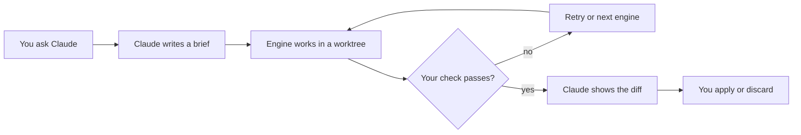

# 🤝 SideTeam


<br/>

### Claude thinks. Your side team types.

Stop spending Claude tokens on boilerplate. **SideTeam** lets Claude Code hand routine coding tasks to the coding agents you already have, such as **Codex**, **OpenCode**, **Gemini CLI** or a **local Ollama model**. Each task runs in its own Git worktree and goes through your test suite. Nothing reaches your branch until you say so.

```text
You     › Delegate a test for empty input in src/validate.ts to codex, check with npm test.
Claude  › codex finished: 1 file changed, check passed ✅
          Here is the diff. Apply it?
You     › Apply.
```

<br/>

## 📋 Summary

* **[📋 Summary](#-summary)**
* **[✨ Why SideTeam](#-why-sideteam)**
* **[🛠️ Install](#️-install)**
* **[🚀 Use](#-use)**
* **[🔌 Engines](#-engines)**
* **[📊 Benchmark](#-benchmark)**
* **[🔒 Security](#-security)**
* **[🧪 Develop](#-develop)**
* **[🤝 Contribute](#-contribute)**
* **[📄 License](#-license)**

<br/>

## ✨ Why SideTeam

* 💸 **Save your Claude budget.** Claude writes a short brief and reviews the result; another engine writes the code.
* 🧪 **Verified, not trusted.** Every run goes through your project's own check command before you see it.
* 🌳 **Isolated.** Each task gets its own branch and worktree. Your working tree is never touched until you apply.
* 🔁 **Self-healing.** A failed check is retried with the error output, then handed to the next engine in your fallback list.
* 🏠 **Local-ready.** Point it at an Ollama model and keep confidential code on your machine.
* 📊 **Measured.** `/sideteam:stats` shows success rates, durations and an estimate of the Claude tokens you saved.
* 📦 **Zero install footprint.** The plugin ships as one bundled file and needs only Node.js.



<br/>

## 🛠️ Install

You need **Claude Code**, **Git**, **Node.js 20+** and at least one engine signed in (for example `codex login`). In Claude Code, run:

```text
/plugin marketplace add sofianehms/sideteam
/plugin install sideteam@sideteam
/sideteam:setup
```

`/sideteam:setup` finds your engines and writes the configuration for you after asking where to save it.

<br/>

## 🚀 Use

Just ask Claude, in any Git repository with at least one commit:

```text
Delegate to codex: add a --json flag to src/cli.ts. Check with npm test.
```

Claude briefs the engine, waits for the check, shows you the diff, then **applies** or **discards** it on your word. To see how much you are saving:

```text
/sideteam:stats
```

Want to set it up by hand? A minimal `.sideteam.json` at the repository root is enough:

```json
{
  "engines": { "codex": { "adapter": "codex" } },
  "check": ["npm", "test"]
}
```

Every option (fallback chains, retries, timeouts, worktree setup, global configuration) is in the **[reference](REFERENCE.md)**.

<br/>

## 🔌 Engines

| Engine | Adapter | Notes |
| --- | --- | --- |
| Codex CLI | `codex` | Runs in its workspace-write sandbox. Also works with local models in OSS mode. |
| OpenCode | `opencode` | Any provider OpenCode supports, including Ollama. |
| Gemini CLI | `gemini` | Not yet verified in real conditions. |
| Anything else | `generic` | Any command-line agent that takes a prompt file. |

Running locally? Start from the [Ollama presets](examples/README.md).

<br/>

## 📊 Benchmark

The light series ran on 2026-11-23. Arm A is Claude Code alone. Arm B is Claude Code with SideTeam loaded and permission to delegate to Codex.

* ⚠️ **SideTeam saved nothing in this series.** Claude never chose to call `delegate` on these small tasks (7 to 17 seconds each), so arm B only paid for the plugin's tool definitions: savings of -0.2%, -2.2% and -6.8%.
* ✅ Success rates were equal in both arms. New results on larger tasks will replace these figures.

<details>
<summary>Full results and limits</summary>

<br/>

* 📅 Date: 2026-11-23T08:49:33.547Z (report generation).
* 🧩 Coverage: 12/18 trials (partial). The `local` engine (OpenCode with Ollama) was not installed on the benchmark machine, so its 6 trials were skipped. Gemini is not part of the light series.
* 🏷️ Versions: Claude Code 2.1.330 with `claude-sonnet-5-5`, Codex CLI 0.169.0. No Codex model was recorded because no trial delegated.
* 🔁 Trials: six light tasks (three TypeScript, three Python; two per difficulty), one repetition per arm, 20-minute limit, Node.js 22.23.5 and Python 3.

| Level | Arm | Engine | Success rate | Median Claude tokens | Median cache read | Savings (1 − B/A) | Median engine tokens | Median duration (s) | Cost per successful task (USD) |
| --- | --- | --- | ---: | ---: | ---: | ---: | ---: | ---: | ---: |
| easy | A | — | 50.0% | 14289 | 65914.5 | n/a | n/a | 6.644 | $0.134427 |
| easy | B | codex | 50.0% | 14320 | 54962.5 | -0.2% | 0 | 7.080 | engine cost n/a |
| medium | A | — | 100.0% | 15083.5 | 66153.5 | n/a | n/a | 10.252 | $0.073166 |
| medium | B | codex | 100.0% | 15416 | 66677.5 | -2.2% | 0 | 10.791 | engine cost n/a |
| hard | A | — | 100.0% | 17140 | 66196.5 | n/a | n/a | 13.873 | $0.086059 |
| hard | B | codex | 100.0% | 18307.5 | 90590.5 | -6.8% | 0 | 17.021 | engine cost n/a |

* ❌ The single failure per arm is `01-ts-slugify`: both arms lowercased before removing non-ASCII characters, so the hidden check on the Kelvin sign (U+212A) failed. No trial timed out, and no failure came from an engine.
* 📏 The sample is small: two trials per row and one repetition. These figures do not support a general conclusion.
* 💵 Claude costs are API-equivalent estimates from Claude Code. The runs used a flat-rate Claude subscription, so no per-trial amount was billed.
* ❔ Engine cost is unknown for subscriptions and local models. Codex ran on a ChatGPT subscription without a configured price, hence `engine cost n/a`.
* 🖥️ No local model was measured, so no Ollama hardware applies to these results.

</details>

<br/>

## 🔒 Security

* 🌳 Engines work in a separate worktree, with a filtered environment and only the variables you allow.
* ☁️ Cloud engines receive your prompts and code. For confidential work, use a local model.
* 🙈 SideTeam sends no telemetry. Prompts, logs and statistics stay on your machine.

Full details are in the [reference](REFERENCE.md#-security).

<br/>

## 🧪 Develop

```console
$ npm ci
$ npm test
$ npm run lint
$ npm run build
$ npm run check:dist
```

The tests use fake engines and temporary repositories. GitHub Actions runs them on Node.js 20 and 22, on Linux and macOS. The plugin runs the checked-in `dist/sideteam.js`, so rebuild it after any change to the bundle. `dist/` is ignored, so add the file with `git add -f`.

<br/>

## 🤝 Contribute

Open pull requests against `dev` and use Conventional Commits.

<br/>

## 📄 License

SideTeam is released under the [MIT License](LICENSE).
